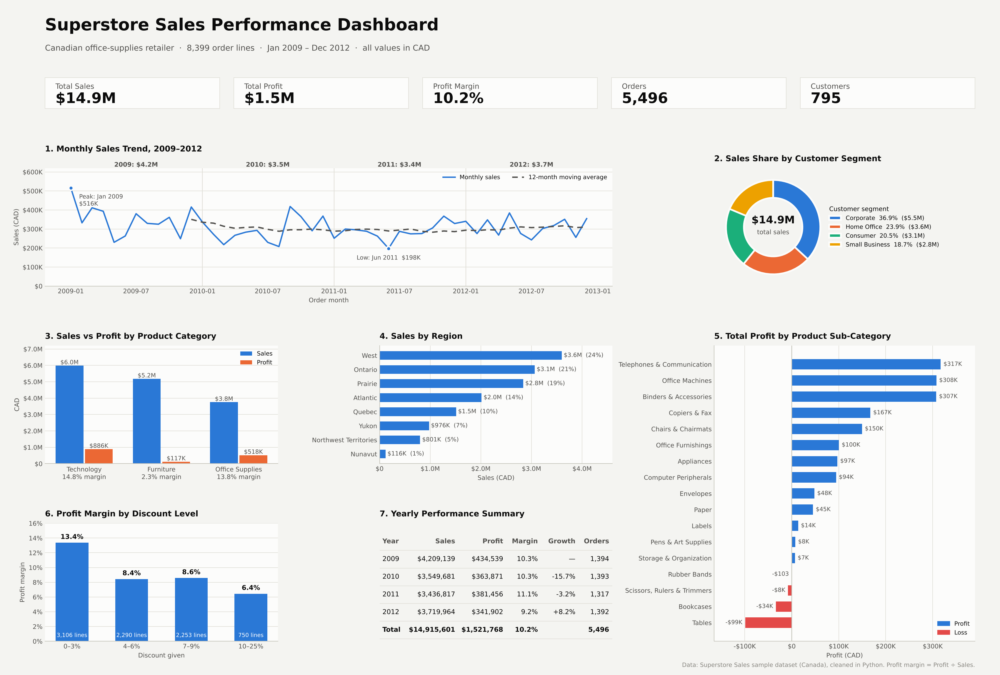

# Superstore Sales Performance Dashboard

Data visualization assignment — **Mohamed Ezzat Mohamed (ID 42510326)**

A one-page dashboard of four years (2009–2012) of sales data from a Canadian office-supplies retailer, built in Python.

## Files

| File | Description |
|---|---|
| [Superstore_Dashboard.pdf](Superstore_Dashboard.pdf) | The dashboard (PDF) |
| [Superstore_Dashboard.png](Superstore_Dashboard.png) | The dashboard (image) |
| [Superstore_Dashboard_Report.docx](Superstore_Dashboard_Report.docx) | Description and interpretation report (Word) |
| [Mohamed_Ezzat_42510326_Dashboard_Assignment.pdf](Mohamed_Ezzat_42510326_Dashboard_Assignment.pdf) | Full submission: report + dashboard + dataset preview (PDF) |
| [Superstore_Sales_Dataset.xlsx](Superstore_Sales_Dataset.xlsx) | Dataset: cleaned data, raw data, data dictionary, cleaning log |
| [superstore_original.csv](superstore_original.csv) | Original dataset (CSV) |
| [superstore_clean.csv](superstore_clean.csv) | Cleaned dataset (CSV) |
| [clean_data.py](clean_data.py) | Data preparation and cleaning script |
| [build_dashboard.py](build_dashboard.py) | Dashboard script (Matplotlib) |

## Tools

Python · pandas · Matplotlib · openpyxl
